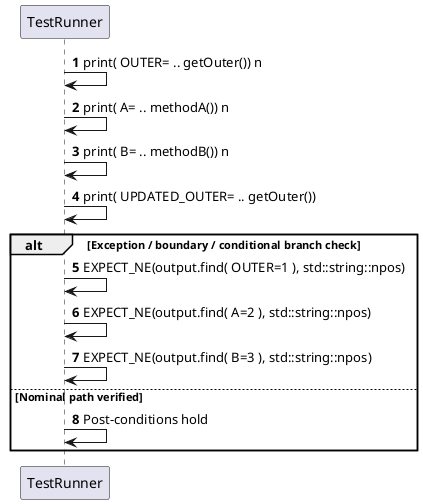

# Test Case: `QlshTest.LexicalScopingCompliance`

| Property | Value |
| :--- | :--- |
| **Module** | `scripting` |
| **Source File** | `cmake-projects/scripting/test/TestQlsh.cpp` (lines 253–279) |
| **Category** | Unit & Regression Verification |
| **Traceability** | See module specification (`FE-*` / `TSK-*`) |
| **Async Telemetry** | Standard GTest / CTest stdout |

## Summary

Verifies that local variables within multiple methods do not interfere (Spec Compliance).

## Sequence Diagram

## Observed Operations

- `"print('OUTER=' .. getOuter())\n"`
- `"print('A=' .. methodA())\n"`
- `"print('B=' .. methodB())\n"`
- `"print('UPDATED_OUTER=' .. getOuter())"`

## Verification Assertions

- `EXPECT_NE(output.find("OUTER=1"), std::string::npos)`
- `EXPECT_NE(output.find("A=2"), std::string::npos)`
- `EXPECT_NE(output.find("B=3"), std::string::npos)`
- `EXPECT_NE(output.find("UPDATED_OUTER=10"), std::string::npos)`

---

[Back to `scripting` Tests Overview](../scripting.md)
