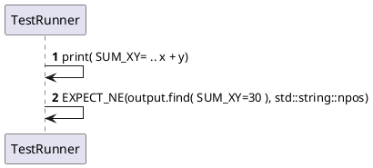

# Test Case: `QlshTest.MultipleGlobalPersistence`

| Property | Value |
| :--- | :--- |
| **Module** | `scripting` |
| **Source File** | `cmake-projects/scripting/test/TestQlsh.cpp` (lines 222–228) |
| **Category** | Unit & Regression Verification |
| **Traceability** | See module specification (`FE-*` / `TSK-*`) |
| **Async Telemetry** | Standard GTest / CTest stdout |

## Summary

Verifies that multiple global variables are persisted.

## Sequence Diagram

## Observed Operations

- `"print('SUM_XY=' .. x + y)"`

## Verification Assertions

- `EXPECT_NE(output.find("SUM_XY=30"), std::string::npos)`

---

[Back to `scripting` Tests Overview](../scripting.md)
