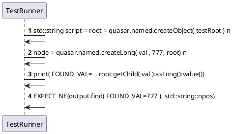

# Test Case: `QlshTest.NamedObjectInteraction`

| Property | Value |
| :--- | :--- |
| **Module** | `scripting` |
| **Source File** | `cmake-projects/scripting/test/TestQlsh.cpp` (lines 97–103) |
| **Category** | Unit & Regression Verification |
| **Traceability** | See module specification (`FE-*` / `TSK-*`) |
| **Async Telemetry** | Standard GTest / CTest stdout |

## Summary

Verifies interaction with the Quasar NamedObject hierarchy.

## Sequence Diagram

## Observed Operations

- `std::string script = "root = quasar.named.createObject('testRoot')\n"`
- `"node = quasar.named.createLong('val', 777, root)\n"`
- `"print('FOUND_VAL=' .. root:getChild('val'):asLong():value())"`

## Verification Assertions

- `EXPECT_NE(output.find("FOUND_VAL=777"), std::string::npos)`

---

[Back to `scripting` Tests Overview](../scripting.md)
