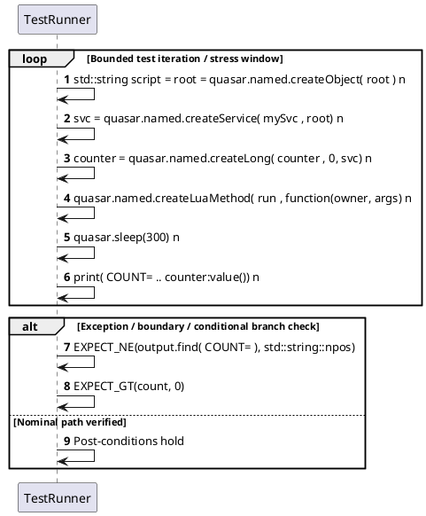

# Test Case: `QlshTest.NamedServiceInShell`

| Property | Value |
| :--- | :--- |
| **Module** | `scripting` |
| **Source File** | `cmake-projects/scripting/test/TestQlsh.cpp` (lines 143–177) |
| **Category** | Unit & Regression Verification |
| **Traceability** | See module specification (`FE-*` / `TSK-*`) |
| **Async Telemetry** | Standard GTest / CTest stdout |

## Summary

Verifies background service execution within qlsh.

## Sequence Diagram

## Observed Operations

- `std::string script = "root = quasar.named.createObject('root')\n"`
- `"svc = quasar.named.createService('mySvc', root)\n"`
- `"counter = quasar.named.createLong('counter', 0, svc)\n"`
- `"quasar.named.createLuaMethod('run', function(owner, args)\n"`
- `"quasar.sleep(300)\n"`
- `"print('COUNT=' .. counter:value())\n"`
- `"quasar.sleep(100)\n"`
- `size_t pos = output.find("COUNT=")`

## Verification Assertions

- `EXPECT_NE(output.find("COUNT="), std::string::npos)`
- `EXPECT_GT(count, 0)`

---

[Back to `scripting` Tests Overview](../scripting.md)
