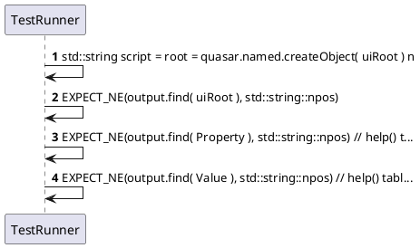

# Test Case: `QlshTest.ShellUtilities`

| Property | Value |
| :--- | :--- |
| **Module** | `scripting` |
| **Source File** | `cmake-projects/scripting/test/TestQlsh.cpp` (lines 130–138) |
| **Category** | Unit & Regression Verification |
| **Traceability** | See module specification (`FE-*` / `TSK-*`) |
| **Async Telemetry** | Standard GTest / CTest stdout |

## Summary

Verifies shell-specific diagnostic utilities (ls, help).

## Sequence Diagram

## Observed Operations

- `std::string script = "root = quasar.named.createObject('uiRoot')\n"`

## Verification Assertions

- `EXPECT_NE(output.find("uiRoot"), std::string::npos)`
- `EXPECT_NE(output.find("Property"), std::string::npos); // help() table header`
- `EXPECT_NE(output.find("Value"), std::string::npos);    // help() table header`

---

[Back to `scripting` Tests Overview](../scripting.md)
