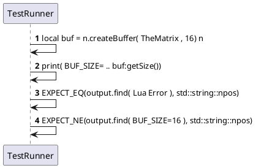

# Test Case: `QlshTest.UserReportedSequenceFix`

| Property | Value |
| :--- | :--- |
| **Module** | `scripting` |
| **Source File** | `cmake-projects/scripting/test/TestQlsh.cpp` (lines 207–217) |
| **Category** | Unit & Regression Verification |
| **Traceability** | See module specification (`FE-*` / `TSK-*`) |
| **Async Telemetry** | Standard GTest / CTest stdout |

## Summary

Reproduces and verifies the fix for the user reported sequence failure.

## Sequence Diagram

## Observed Operations

- `"local buf = n.createBuffer('TheMatrix', 16)\n"`
- `"print('BUF_SIZE=' .. buf:getSize())"`

## Verification Assertions

- `EXPECT_EQ(output.find("Lua Error"), std::string::npos)`
- `EXPECT_NE(output.find("BUF_SIZE=16"), std::string::npos)`

---

[Back to `scripting` Tests Overview](../scripting.md)
