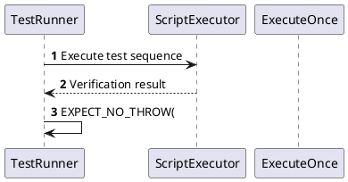

# Test Case: `ScriptExecutorTest.ExecuteOnce`

| Property | Value |
| :--- | :--- |
| **Module** | `scripting` |
| **Source File** | `cmake-projects/scripting/test/TestScriptExecution.cpp` (lines 13–18) |
| **Category** | Unit & Regression Verification |
| **Traceability** | See module specification (`FE-*` / `TSK-*`) |
| **Async Telemetry** | Standard GTest / CTest stdout |

## Summary

Executes verification scenario `ScriptExecutorTest.ExecuteOnce` defined in `cmake-projects/scripting/test/TestScriptExecution.cpp`.

## Sequence Diagram

## Observed Operations

- Invokes standalone executable entry flow.

## Verification Assertions

- `EXPECT_NO_THROW({`

---

[Back to `scripting` Tests Overview](../scripting.md)
