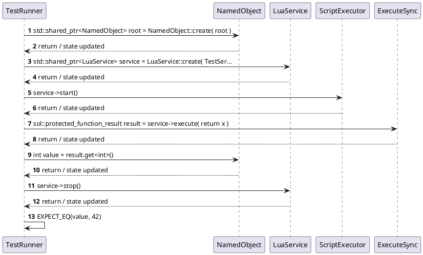

# Test Case: `ScriptExecutorTest.ExecuteSync`

| Property | Value |
| :--- | :--- |
| **Module** | `scripting` |
| **Source File** | `cmake-projects/scripting/test/TestScriptExecution.cpp` (lines 20–32) |
| **Category** | Unit & Regression Verification |
| **Traceability** | See module specification (`FE-*` / `TSK-*`) |
| **Async Telemetry** | Standard GTest / CTest stdout |

## Summary

Executes verification scenario `ScriptExecutorTest.ExecuteSync` defined in `cmake-projects/scripting/test/TestScriptExecution.cpp`.

## Sequence Diagram

## Observed Operations

- `std::shared_ptr<NamedObject> root = NamedObject::create("root")`
- `std::shared_ptr<LuaService> service = LuaService::create("TestService", root)`
- `service->start()`
- `sol::protected_function_result result = service->execute("return x")`
- `int value = result.get<int>()`
- `service->stop()`

## Verification Assertions

- `EXPECT_EQ(value, 42)`

---

[Back to `scripting` Tests Overview](../scripting.md)
