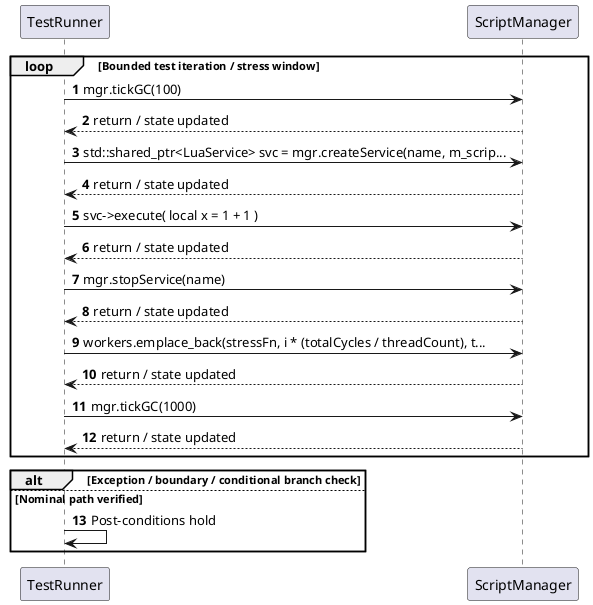

# Test Case: `ScriptManagerTest.MemoryStress`

| Property | Value |
| :--- | :--- |
| **Module** | `scripting` |
| **Source File** | `cmake-projects/scripting/test/TestScriptManager.cpp` (lines 31–70) |
| **Category** | Determinism, Fuzzing, Concurrency & Stress (`CS-0100.7`, `CS-0100.10`, `CS-0100.11`, `CS-0100.12`) |
| **Traceability** | See module specification (`FE-*` / `TSK-*`) |
| **Async Telemetry** | Standard GTest / CTest stdout |

## Summary

Executes verification scenario `ScriptManagerTest.MemoryStress` defined in `cmake-projects/scripting/test/TestScriptManager.cpp`.

## Sequence Diagram

## Observed Operations

- `mgr.tickGC(100)`
- `std::shared_ptr<LuaService> svc = mgr.createService(name, m_scriptPath)`
- `svc->execute("local x = 1 + 1")`
- `mgr.stopService(name)`
- `workers.emplace_back(stressFn, i * (totalCycles / threadCount), totalCycles / threadCount)`
- `mgr.tickGC(1000)`

## Verification Assertions

- Verified via exit status `0` and runtime checks inside executable.

---

[Back to `scripting` Tests Overview](../scripting.md)
