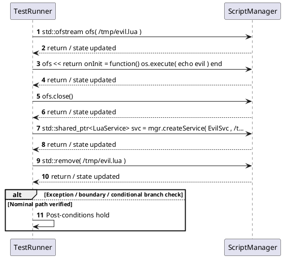

# Test Case: `ScriptManagerTest.SandboxIsolation`

| Property | Value |
| :--- | :--- |
| **Module** | `scripting` |
| **Source File** | `cmake-projects/scripting/test/TestScriptManager.cpp` (lines 72–87) |
| **Category** | Unit & Regression Verification |
| **Traceability** | See module specification (`FE-*` / `TSK-*`) |
| **Async Telemetry** | Standard GTest / CTest stdout |

## Summary

Executes verification scenario `ScriptManagerTest.SandboxIsolation` defined in `cmake-projects/scripting/test/TestScriptManager.cpp`.

## Sequence Diagram

## Observed Operations

- `std::ofstream ofs("/tmp/evil.lua")`
- `ofs << "return { onInit = function() os.execute('echo evil') end }"`
- `ofs.close()`
- `std::shared_ptr<LuaService> svc = mgr.createService("EvilSvc", "/tmp/evil.lua")`
- `std::remove("/tmp/evil.lua")`

## Verification Assertions

- Verified via exit status `0` and runtime checks inside executable.

---

[Back to `scripting` Tests Overview](../scripting.md)
