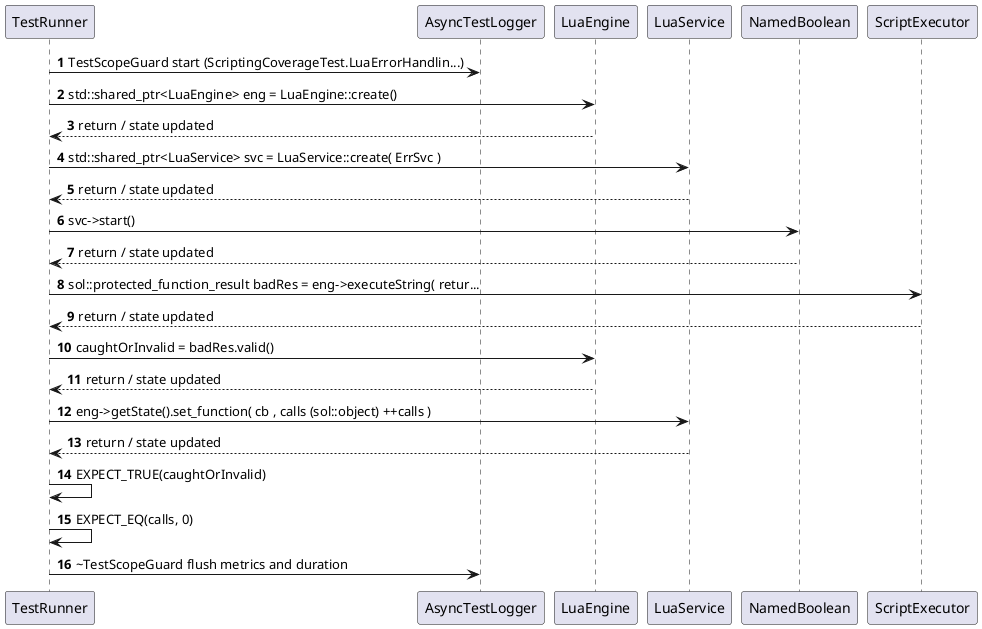

# Test Case: `ScriptingCoverageTest.LuaErrorHandlingAndObserverInvalidation`

| Property | Value |
| :--- | :--- |
| **Module** | `scripting` |
| **Source File** | `cmake-projects/scripting/test_cs0100/TestScriptingExtended.cpp` (lines 142–168) |
| **Category** | Coverage, Enum, Boundary & Exception Containment (`CS-0100.1`, `CS-0100.3`, `CS-0100.4`, `CS-0100.6`, `CS-0100.9`) |
| **Traceability** | `[TSK-20260311-011]`, `[TSK-20260328-001]`, `[FE-0130]`, `[CS-0010.37]` |
| **Async Telemetry** | Enabled (`TestScopeGuard` + `AsyncTestLogger`) |

## Summary

Extended CS-0100 test suite for `quasar_scripting` covering `ScriptExecutor`, `LuaFuture`, `LuaObserver`, `QueuedObserver`, `ObjectTracker`, `ShellUtilities`, exceptions, fuzzing, and concurrency.

## Sequence Diagram

## Observed Operations

- `std::shared_ptr<LuaEngine> eng = LuaEngine::create()`
- `std::shared_ptr<LuaService> svc = LuaService::create("ErrSvc")`
- `svc->start()`
- `sol::protected_function_result badRes = eng->executeString("return (1 +")`
- `caughtOrInvalid = !badRes.valid()`
- `eng->getState().set_function("cb", [&calls](sol::object) { ++calls; })`
- `LuaObserver obs(eng->getState()["cb"], eng.get(), svc)`
- `std::shared_ptr<named::NamedBoolean> flag = named::NamedBoolean::create("Flag", true)`

## Verification Assertions

- `EXPECT_TRUE(caughtOrInvalid)`
- `EXPECT_EQ(calls, 0)`

---

[Back to `scripting` Tests Overview](../scripting.md)
