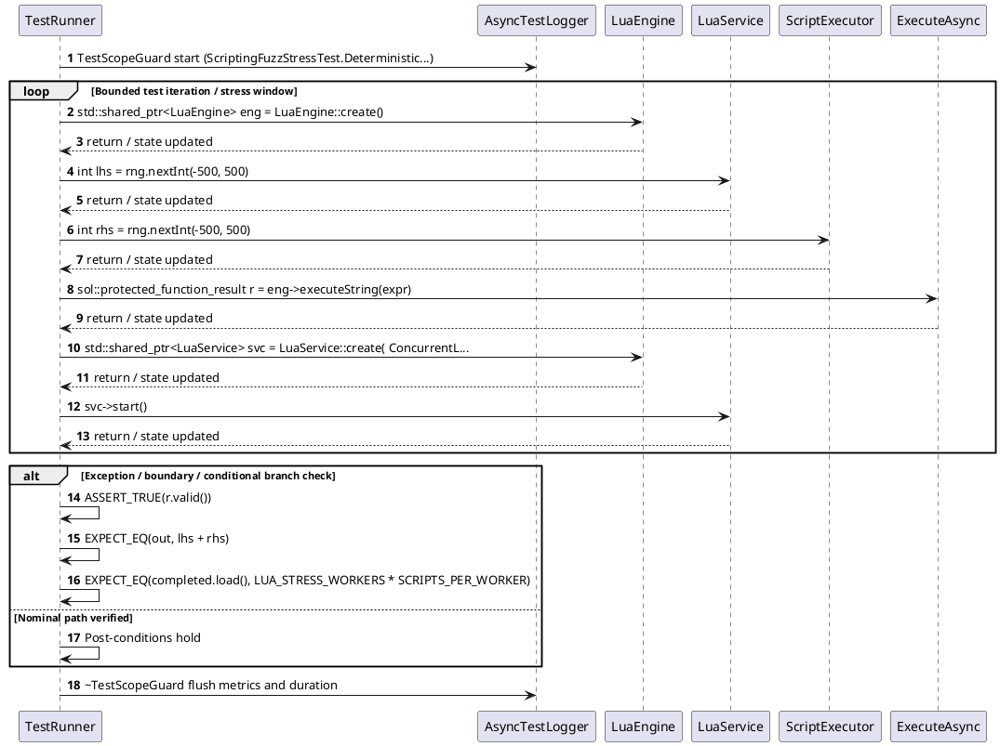

# Test Case: `ScriptingFuzzStressTest.DeterministicLuaFuzzAndConcurrentServiceStress`

| Property | Value |
| :--- | :--- |
| **Module** | `scripting` |
| **Source File** | `cmake-projects/scripting/test_cs0100/TestScriptingExtended.cpp` (lines 170–223) |
| **Category** | Determinism, Fuzzing, Concurrency & Stress (`CS-0100.7`, `CS-0100.10`, `CS-0100.11`, `CS-0100.12`) |
| **Traceability** | `[TSK-20260311-011]`, `[TSK-20260328-001]`, `[FE-0130]`, `[CS-0010.37]` |
| **Async Telemetry** | Enabled (`TestScopeGuard` + `AsyncTestLogger`) |

## Summary

Extended CS-0100 test suite for `quasar_scripting` covering `ScriptExecutor`, `LuaFuture`, `LuaObserver`, `QueuedObserver`, `ObjectTracker`, `ShellUtilities`, exceptions, fuzzing, and concurrency.

## Sequence Diagram

## Observed Operations

- `std::shared_ptr<LuaEngine> eng = LuaEngine::create()`
- `int lhs = rng.nextInt(-500, 500)`
- `int rhs = rng.nextInt(-500, 500)`
- `sol::protected_function_result r = eng->executeString(expr)`
- `std::shared_ptr<LuaService> svc = LuaService::create("ConcurrentLuaSvc")`
- `svc->start()`
- `workers.reserve(LUA_STRESS_WORKERS)`
- `workers.emplace_back([&svc, &completed, w]() {`

## Verification Assertions

- `ASSERT_TRUE(r.valid())`
- `EXPECT_EQ(out, lhs + rhs)`
- `EXPECT_EQ(completed.load(), LUA_STRESS_WORKERS * SCRIPTS_PER_WORKER)`

---

[Back to `scripting` Tests Overview](../scripting.md)
