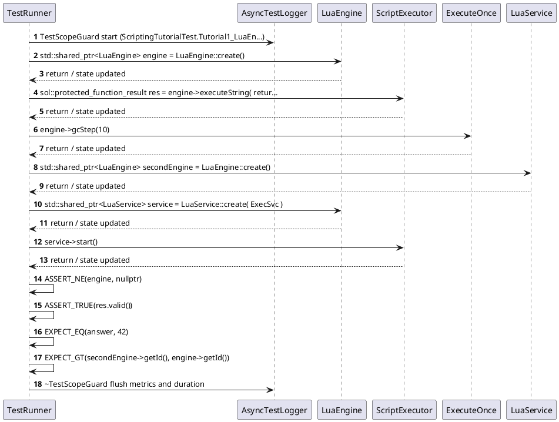

# Test Case: `ScriptingTutorialTest.Tutorial1_LuaEngineAndScriptExecutorModes`

| Property | Value |
| :--- | :--- |
| **Module** | `scripting` |
| **Source File** | `cmake-projects/scripting/test_cs0100/TestScriptingExtended.cpp` (lines 73–94) |
| **Category** | Pedagogical Tutorial (`CS-0100.19`) |
| **Traceability** | `[TSK-20260311-011]`, `[TSK-20260328-001]`, `[FE-0130]`, `[CS-0010.37]` |
| **Async Telemetry** | Enabled (`TestScopeGuard` + `AsyncTestLogger`) |

## Summary

Extended CS-0100 test suite for `quasar_scripting` covering `ScriptExecutor`, `LuaFuture`, `LuaObserver`, `QueuedObserver`, `ObjectTracker`, `ShellUtilities`, exceptions, fuzzing, and concurrency.

## Sequence Diagram

## Observed Operations

- `std::shared_ptr<LuaEngine> engine = LuaEngine::create()`
- `sol::protected_function_result res = engine->executeString("return 6 * 7")`
- `engine->gcStep(10)`
- `std::shared_ptr<LuaEngine> secondEngine = LuaEngine::create()`
- `std::shared_ptr<LuaService> service = LuaService::create("ExecSvc")`
- `service->start()`
- `service->stop()`
- `logOutput("luaAnswer", answer)`

## Verification Assertions

- `ASSERT_NE(engine, nullptr)`
- `ASSERT_TRUE(res.valid())`
- `EXPECT_EQ(answer, 42)`
- `EXPECT_GT(secondEngine->getId(), engine->getId())`
- `EXPECT_EQ(static_cast<int>(service->getEngine()->getState()["globalPing"]), 99)`

---

[Back to `scripting` Tests Overview](../scripting.md)
