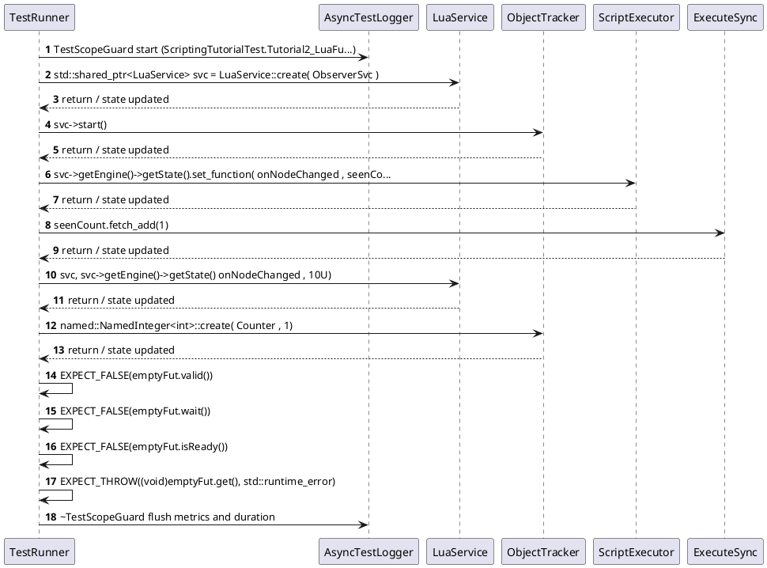

# Test Case: `ScriptingTutorialTest.Tutorial2_LuaFutureQueuedObserverAndTracker`

| Property | Value |
| :--- | :--- |
| **Module** | `scripting` |
| **Source File** | `cmake-projects/scripting/test_cs0100/TestScriptingExtended.cpp` (lines 96–127) |
| **Category** | Pedagogical Tutorial (`CS-0100.19`) |
| **Traceability** | `[TSK-20260311-011]`, `[TSK-20260328-001]`, `[FE-0130]`, `[CS-0010.37]` |
| **Async Telemetry** | Enabled (`TestScopeGuard` + `AsyncTestLogger`) |

## Summary

Extended CS-0100 test suite for `quasar_scripting` covering `ScriptExecutor`, `LuaFuture`, `LuaObserver`, `QueuedObserver`, `ObjectTracker`, `ShellUtilities`, exceptions, fuzzing, and concurrency.

## Sequence Diagram

## Observed Operations

- `std::shared_ptr<LuaService> svc = LuaService::create("ObserverSvc")`
- `svc->start()`
- `svc->getEngine()->getState().set_function("onNodeChanged", [&seenCount]() {`
- `seenCount.fetch_add(1)`
- `svc, svc->getEngine()->getState()["onNodeChanged"], 10U)`
- `named::NamedInteger<int>::create("Counter", 1)`
- `ObjectTracker::getInstance().track(counter)`
- `qObs->notify(counter)`

## Verification Assertions

- `EXPECT_FALSE(emptyFut.valid())`
- `EXPECT_FALSE(emptyFut.wait())`
- `EXPECT_FALSE(emptyFut.isReady())`
- `EXPECT_THROW((void)emptyFut.get(), std::runtime_error)`
- `EXPECT_TRUE(ObjectTracker::getInstance().isAlive(counter))`
- `EXPECT_GE(seenCount.load(), 1)`

---

[Back to `scripting` Tests Overview](../scripting.md)
