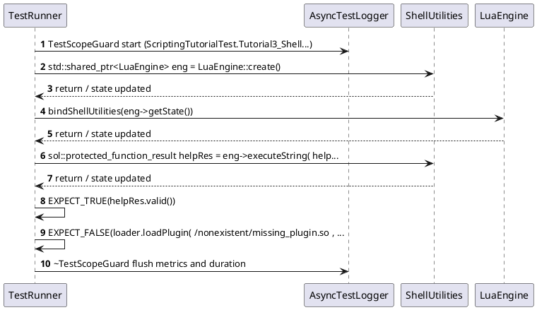

# Test Case: `ScriptingTutorialTest.Tutorial3_ShellUtilitiesAndPluginBoundaries`

| Property | Value |
| :--- | :--- |
| **Module** | `scripting` |
| **Source File** | `cmake-projects/scripting/test_cs0100/TestScriptingExtended.cpp` (lines 129–140) |
| **Category** | Pedagogical Tutorial (`CS-0100.19`) |
| **Traceability** | `[TSK-20260311-011]`, `[TSK-20260328-001]`, `[FE-0130]`, `[CS-0010.37]` |
| **Async Telemetry** | Enabled (`TestScopeGuard` + `AsyncTestLogger`) |

## Summary

Extended CS-0100 test suite for `quasar_scripting` covering `ScriptExecutor`, `LuaFuture`, `LuaObserver`, `QueuedObserver`, `ObjectTracker`, `ShellUtilities`, exceptions, fuzzing, and concurrency.

## Sequence Diagram

## Observed Operations

- `std::shared_ptr<LuaEngine> eng = LuaEngine::create()`
- `bindShellUtilities(eng->getState())`
- `sol::protected_function_result helpRes = eng->executeString("help()")`

## Verification Assertions

- `EXPECT_TRUE(helpRes.valid())`
- `EXPECT_FALSE(loader.loadPlugin("/nonexistent/missing_plugin.so", eng->getState()))`

---

[Back to `scripting` Tests Overview](../scripting.md)
