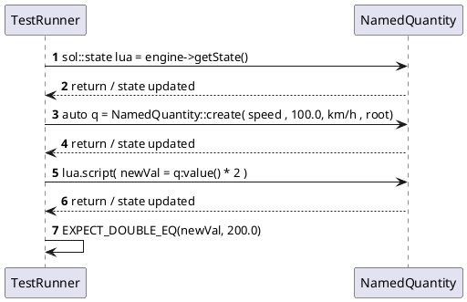

# Test Case: `TypeBindingsTest.QuantityMath`

| Property | Value |
| :--- | :--- |
| **Module** | `scripting` |
| **Source File** | `cmake-projects/scripting/test/TestTypeBindings.cpp` (lines 53–61) |
| **Category** | Unit & Regression Verification |
| **Traceability** | See module specification (`FE-*` / `TSK-*`) |
| **Async Telemetry** | Standard GTest / CTest stdout |

## Summary

Executes verification scenario `TypeBindingsTest.QuantityMath` defined in `cmake-projects/scripting/test/TestTypeBindings.cpp`.

## Sequence Diagram

## Observed Operations

- `sol::state& lua = engine->getState()`
- `auto q = NamedQuantity::create("speed", 100.0, "km/h", root)`
- `lua.script("newVal = q:value() * 2")`

## Verification Assertions

- `EXPECT_DOUBLE_EQ(newVal, 200.0)`

---

[Back to `scripting` Tests Overview](../scripting.md)
