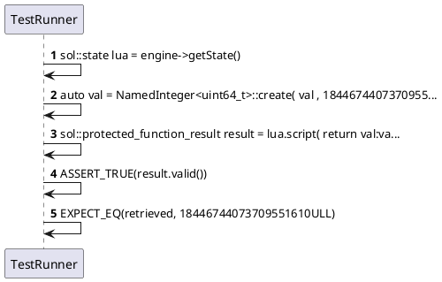

# Test Case: `TypeBindingsTest.UnsignedIntegerPrecision`

| Property | Value |
| :--- | :--- |
| **Module** | `scripting` |
| **Source File** | `cmake-projects/scripting/test/TestTypeBindings.cpp` (lines 42–51) |
| **Category** | Unit & Regression Verification |
| **Traceability** | See module specification (`FE-*` / `TSK-*`) |
| **Async Telemetry** | Standard GTest / CTest stdout |

## Summary

Executes verification scenario `TypeBindingsTest.UnsignedIntegerPrecision` defined in `cmake-projects/scripting/test/TestTypeBindings.cpp`.

## Sequence Diagram

## Observed Operations

- `sol::state& lua = engine->getState()`
- `auto val = NamedInteger<uint64_t>::create("val", 18446744073709551610ULL, root)`
- `sol::protected_function_result result = lua.script("return val:value()")`

## Verification Assertions

- `ASSERT_TRUE(result.valid())`
- `EXPECT_EQ(retrieved, 18446744073709551610ULL)`

---

[Back to `scripting` Tests Overview](../scripting.md)
