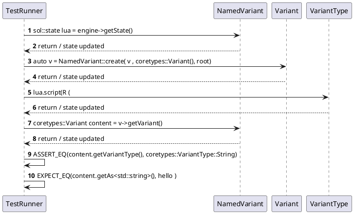

# Test Case: `TypeBindingsTest.VariantHandling`

| Property | Value |
| :--- | :--- |
| **Module** | `scripting` |
| **Source File** | `cmake-projects/scripting/test/TestTypeBindings.cpp` (lines 79–91) |
| **Category** | Unit & Regression Verification |
| **Traceability** | See module specification (`FE-*` / `TSK-*`) |
| **Async Telemetry** | Standard GTest / CTest stdout |

## Summary

Executes verification scenario `TypeBindingsTest.VariantHandling` defined in `cmake-projects/scripting/test/TestTypeBindings.cpp`.

## Sequence Diagram

## Observed Operations

- `sol::state& lua = engine->getState()`
- `auto v = NamedVariant::create("v", coretypes::Variant(), root)`
- `lua.script(R"(`
- `coretypes::Variant content = v->getVariant()`

## Verification Assertions

- `ASSERT_EQ(content.getVariantType(), coretypes::VariantType::String)`
- `EXPECT_EQ(content.getAs<std::string>(), "hello")`

---

[Back to `scripting` Tests Overview](../scripting.md)
