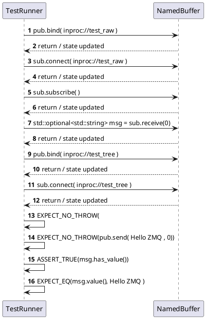

# Test Case: `ZmqPluginTest`

| Property | Value |
| :--- | :--- |
| **Module** | `scripting` |
| **Source File** | `cmake-projects/scripting/plugins/zmq/test/TestZmqPlugin.cpp` (lines 1–92) |
| **Category** | Unit & Regression Verification |
| **Traceability** | See module specification (`FE-*` / `TSK-*`) |
| **Async Telemetry** | Standard GTest / CTest stdout |

## Summary

Executes verification scenario `ZmqPluginTest` defined in `cmake-projects/scripting/plugins/zmq/test/TestZmqPlugin.cpp`.

## Sequence Diagram

## Observed Operations

- `pub.bind("inproc://test_raw")`
- `sub.connect("inproc://test_raw")`
- `sub.subscribe("")`
- `std::optional<std::string> msg = sub.receive(0)`
- `pub.bind("inproc://test_tree")`
- `sub.connect("inproc://test_tree")`
- `sub.subscribe("mytopic")`
- `std::shared_ptr<NamedBuffer> buf = NamedBuffer::create("mybuffer", data)`

## Verification Assertions

- `EXPECT_NO_THROW({`
- `EXPECT_NO_THROW(pub.send("Hello ZMQ", 0))`
- `ASSERT_TRUE(msg.has_value())`
- `EXPECT_EQ(msg.value(), "Hello ZMQ")`
- `EXPECT_NO_THROW(pub.publishTree("mytopic", buf))`
- `EXPECT_NO_THROW({`
- `ASSERT_NE(received, nullptr)`
- `EXPECT_EQ(received->getName(), "mybuffer")`
- `EXPECT_EQ(received->getType(), "NamedBuffer")`
- `ASSERT_NE(rxBuf, nullptr)`

---

[Back to `scripting` Tests Overview](../scripting.md)
