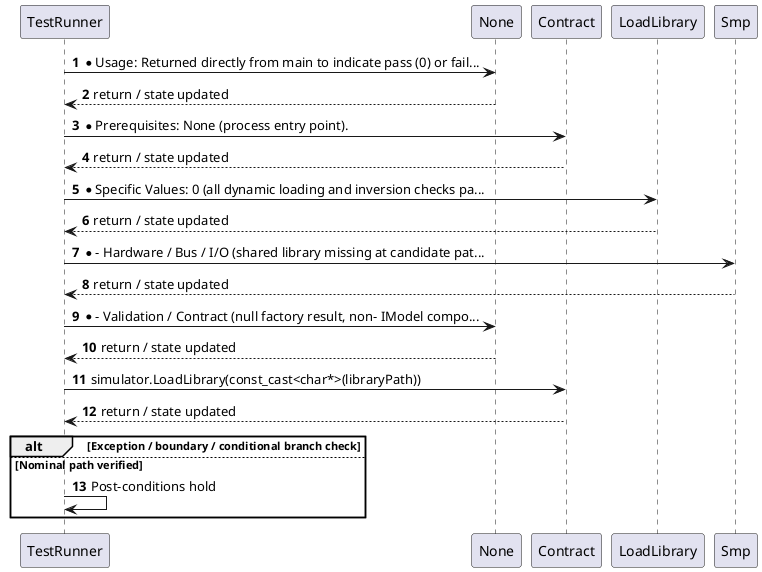

# Test Case: `dynamic-sim-test`

| Property | Value |
| :--- | :--- |
| **Module** | `sim-test` |
| **Source File** | `cmake-projects/sim-test/src/dynamic_main.cpp` (lines 1–191) |
| **Category** | Cross-Module / Third-Party Integration (`CS-0100.16`–`CS-0100.18`) |
| **Traceability** | `TSK-20261113-003`, `FE-0020`, `CS-0010,`, `CS-0010.15,` |
| **Async Telemetry** | Standard GTest / CTest stdout |

## Summary

Dynamic SMP model loading test verifying factory instantiation and execution without link-time dependency.

## Sequence Diagram

## Observed Operations

- `*   Usage: Returned directly from `main` to indicate pass (0) or failure (1).`
- `*   Prerequisites: None (process entry point).`
- `*   Specific Values: 0 (all dynamic loading and inversion checks passed); 1 (library load, state, lookup, or behavior failed).`
- `*   - Hardware / Bus / I/O (shared library missing at candidate paths): Caught across three nested `try`/`catch` blocks; logs each attempt and returns 1 if all fail.`
- `*   - Validation / Contract (null factory result, non-`IModel` component, state mismatch, missing field/entry point, or wrong inversion output): Logs diagnostic to `std::cerr` and returns 1.`
- `simulator.LoadLibrary(const_cast<char*>(libraryPath))`
- `std::cerr << "Failed to load library: " << e.what() << std::endl`
- `simulator.LoadLibrary(const_cast<char*>(libraryPath))`

## Verification Assertions

- Verified via exit status `0` and runtime checks inside executable.

---

[Back to `sim-test` Tests Overview](../sim-test.md)
