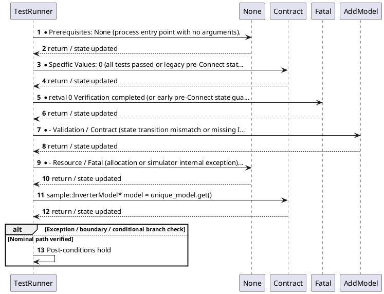

# Test Case: `sim-test`

| Property | Value |
| :--- | :--- |
| **Module** | `sim-test` |
| **Source File** | `cmake-projects/sim-test/src/main.cpp` (lines 1–151) |
| **Category** | Cross-Module / Third-Party Integration (`CS-0100.16`–`CS-0100.18`) |
| **Traceability** | `TSK-20261113-003`, `FE-0020`, `CS-0010,`, `CS-0010.10,` |
| **Async Telemetry** | Standard GTest / CTest stdout |

## Summary

Static SMP simulation test executable validating `sample::InverterModel` lifecycle and boolean feedback.

## Sequence Diagram

## Observed Operations

- `*   Prerequisites: None (process entry point with no arguments).`
- `*   Specific Values: 0 (all tests passed or legacy pre-Connect state abort); 1 (Connect, field lookup, or behavior check failed).`
- `* @retval 0 Verification completed (or early pre-Connect state guard exited per existing logic).`
- `*   - Validation / Contract (state transition mismatch or missing `Input`/`Output` fields): Logs diagnostic to `std::cerr` and returns deterministically.`
- `*   - Resource / Fatal (allocation or simulator internal exception): Stack unwinds cleanly via RAII `simulator` destructor before process exit.`
- `sample::InverterModel* model = unique_model.get()`
- `simulator.AddModel(unique_model.release())`
- `simulator.Publish()`

## Verification Assertions

- Verified via exit status `0` and runtime checks inside executable.

---

[Back to `sim-test` Tests Overview](../sim-test.md)
