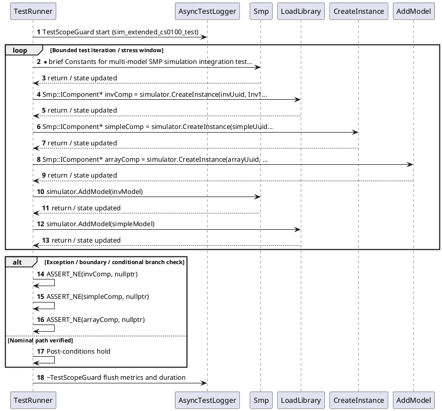

# Test Case: `sim_extended_cs0100_test`

| Property | Value |
| :--- | :--- |
| **Module** | `sim-test` |
| **Source File** | `cmake-projects/sim-test/src/test_sim_extended_cs0100.cpp` (lines 1–151) |
| **Category** | Cross-Module / Third-Party Integration (`CS-0100.16`–`CS-0100.18`) |
| **Traceability** | `TSK-20261113-004`, `FE-0020,`, `CS-0010,`, `CS-0040.1,` |
| **Async Telemetry** | Enabled (`TestScopeGuard` + `AsyncTestLogger`) |

## Summary

CS-0100 multi-library SMP simulator integration test inside `sim-test`.

## Sequence Diagram

## Observed Operations

- `* @brief Constants for multi-model SMP simulation integration tests (`CS-0040`).`
- `Smp::IComponent* invComp = simulator.CreateInstance(invUuid, "Inv1", "Dynamic Inverter", nullptr)`
- `Smp::IComponent* simpleComp = simulator.CreateInstance(simpleUuid, "DelayScalar1", "Dynamic Scalar", nullptr)`
- `Smp::IComponent* arrayComp = simulator.CreateInstance(arrayUuid, "DelayArray1", "Dynamic Array", nullptr)`
- `simulator.AddModel(invModel)`
- `simulator.AddModel(simpleModel)`
- `simulator.AddModel(arrayModel)`
- `simulator.Publish()`

## Verification Assertions

- `ASSERT_NE(invComp, nullptr)`
- `ASSERT_NE(simpleComp, nullptr)`
- `ASSERT_NE(arrayComp, nullptr)`
- `ASSERT_NE(invModel, nullptr)`
- `ASSERT_NE(simpleModel, nullptr)`
- `ASSERT_NE(arrayModel, nullptr)`
- `ASSERT_NE(invEp, nullptr)`
- `ASSERT_NE(simpleEp, nullptr)`
- `ASSERT_NE(arrayEp, nullptr)`
- `ASSERT_NE(invIn, nullptr)`

---

[Back to `sim-test` Tests Overview](../sim-test.md)
