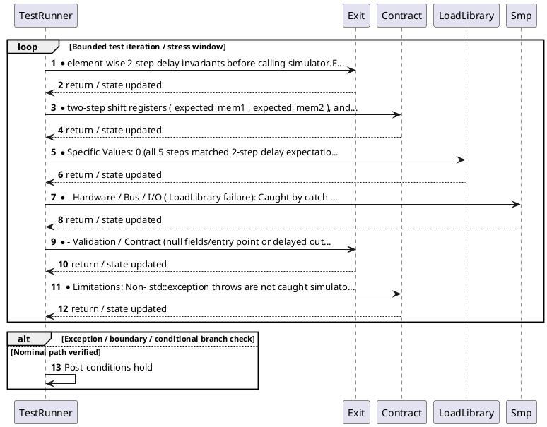

# Test Case: `test-delayed-array`

| Property | Value |
| :--- | :--- |
| **Module** | `sim-test` |
| **Source File** | `cmake-projects/sim-test/src/test_delayed_array.cpp` (lines 1–133) |
| **Category** | Cross-Module / Third-Party Integration (`CS-0100.16`–`CS-0100.18`) |
| **Traceability** | `TSK-20261113-003`, `FE-0020`, `CS-0010,`, `CS-0010.15,` |
| **Async Telemetry** | Standard GTest / CTest stdout |

## Summary

Entry point validating the 2-step delayed array SMP model.

## Sequence Diagram

## Observed Operations

- `* element-wise 2-step delay invariants before calling `simulator.Exit()`.`
- `* two-step shift registers (`expected_mem1`, `expected_mem2`), and exits cleanly.`
- `*   Specific Values: 0 (all 5 steps matched 2-step delay expectation); 1 (missing interface, value mismatch, or caught exception).`
- `*   - Hardware / Bus / I/O (`LoadLibrary` failure): Caught by `catch (const std::exception&)`; logs error and returns 1.`
- `*   - Validation / Contract (null fields/entry point or delayed output mismatch): Logs error and returns 1.`
- `*   Limitations: Non-`std::exception` throws are not caught; `simulator.Exit()` is skipped on early failure returns.`
- `Smp::ISimpleArrayField* inArray = dynamic_cast<Smp::ISimpleArrayField*>(component->GetField("InputArray"))`
- `Smp::ISimpleArrayField* outArray = dynamic_cast<Smp::ISimpleArrayField*>(component->GetField("OutputArray"))`

## Verification Assertions

- Verified via exit status `0` and runtime checks inside executable.

---

[Back to `sim-test` Tests Overview](../sim-test.md)
