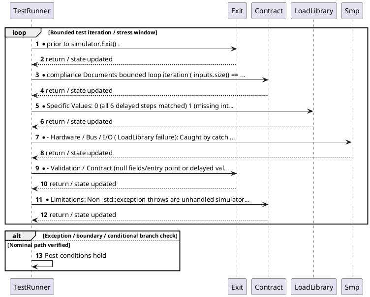

# Test Case: `test-delayed-simple`

| Property | Value |
| :--- | :--- |
| **Module** | `sim-test` |
| **Source File** | `cmake-projects/sim-test/src/test_delayed_simple.cpp` (lines 1–116) |
| **Category** | Cross-Module / Third-Party Integration (`CS-0100.16`–`CS-0100.18`) |
| **Traceability** | `TSK-20261113-003`, `FE-0020`, `CS-0010,`, `CS-0010.15,` |
| **Async Telemetry** | Standard GTest / CTest stdout |

## Summary

Entry point validating the 2-step delayed scalar SMP model.

## Sequence Diagram

## Observed Operations

- `* prior to `simulator.Exit()`.`
- `* @compliance Documents bounded loop iteration (`inputs.size()` == 6), null/type checks,`
- `*   Specific Values: 0 (all 6 delayed steps matched); 1 (missing interface, mismatch, or caught exception).`
- `*   - Hardware / Bus / I/O (`LoadLibrary` failure): Caught by `catch (const std::exception&)`; logs error and returns 1.`
- `*   - Validation / Contract (null fields/entry point or delayed value mismatch): Logs error and returns 1.`
- `*   Limitations: Non-`std::exception` throws are unhandled; `simulator.Exit()` is skipped on early failure returns.`
- `Smp::ISimpleField* inInt32 = dynamic_cast<Smp::ISimpleField*>(component->GetField("Input_Int32"))`
- `Smp::ISimpleField* outInt32 = dynamic_cast<Smp::ISimpleField*>(component->GetField("Output_Int32"))`

## Verification Assertions

- Verified via exit status `0` and runtime checks inside executable.

---

[Back to `sim-test` Tests Overview](../sim-test.md)
