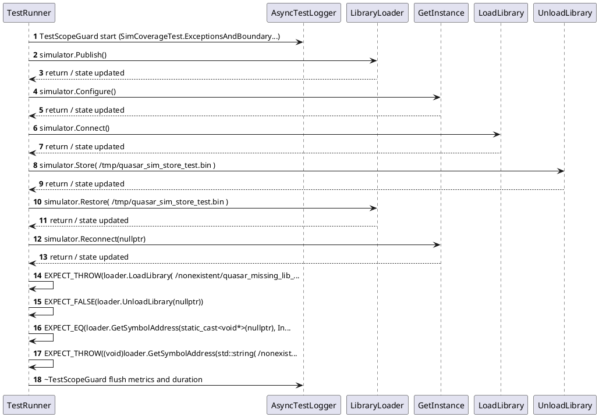

# Test Case: `SimCoverageTest.ExceptionsAndBoundaryStates`

| Property | Value |
| :--- | :--- |
| **Module** | `sim` |
| **Source File** | `cmake-projects/sim/test/TestSimExtended.cpp` (lines 406–430) |
| **Category** | Coverage, Enum, Boundary & Exception Containment (`CS-0100.1`, `CS-0100.3`, `CS-0100.4`, `CS-0100.6`, `CS-0100.9`) |
| **Traceability** | `TSK-20261113-004`, `FE-0070.7,`, `CS-0090.1,` |
| **Async Telemetry** | Enabled (`TestScopeGuard` + `AsyncTestLogger`) |

## Summary

Tests `LibraryLoader`, `Simulator` error states, `Store`/`Restore`, `Abort`, and null guards.

## Sequence Diagram

## Observed Operations

- `simulator.Publish()`
- `simulator.Configure()`
- `simulator.Connect()`
- `simulator.Store("/tmp/quasar_sim_store_test.bin")`
- `simulator.Restore("/tmp/quasar_sim_store_test.bin")`
- `simulator.Reconnect(nullptr)`
- `simulator.Abort()`

## Verification Assertions

- `EXPECT_THROW(loader.LoadLibrary("/nonexistent/quasar_missing_lib_xyz.so"), sim::LibraryException)`
- `EXPECT_FALSE(loader.UnloadLibrary(nullptr))`
- `EXPECT_EQ(loader.GetSymbolAddress(static_cast<void*>(nullptr), "Initialise"), nullptr)`
- `EXPECT_THROW((void)loader.GetSymbolAddress(std::string("/nonexistent"), "Initialise"), sim::LibraryException)`
- `EXPECT_EQ(simulator.GetService("NonExistentService"), nullptr)`
- `EXPECT_EQ(simulator.GetFactory({99U, 99U, 99U, 99U, 99ULL}), nullptr)`
- `EXPECT_EQ(simulator.CreateInstance({99U, 99U, 99U, 99U, 99ULL}, "Bad", "", nullptr), nullptr)`
- `EXPECT_THROW(simulator.Store("/tmp/quasar_sim_store_test.bin"), core::InvalidSimulatorState)`
- `EXPECT_THROW(simulator.Restore("/tmp/quasar_sim_store_test.bin"), core::InvalidSimulatorState)`
- `EXPECT_THROW(simulator.Reconnect(nullptr), core::InvalidSimulatorState)`

---

[Back to `sim` Tests Overview](../sim.md)
