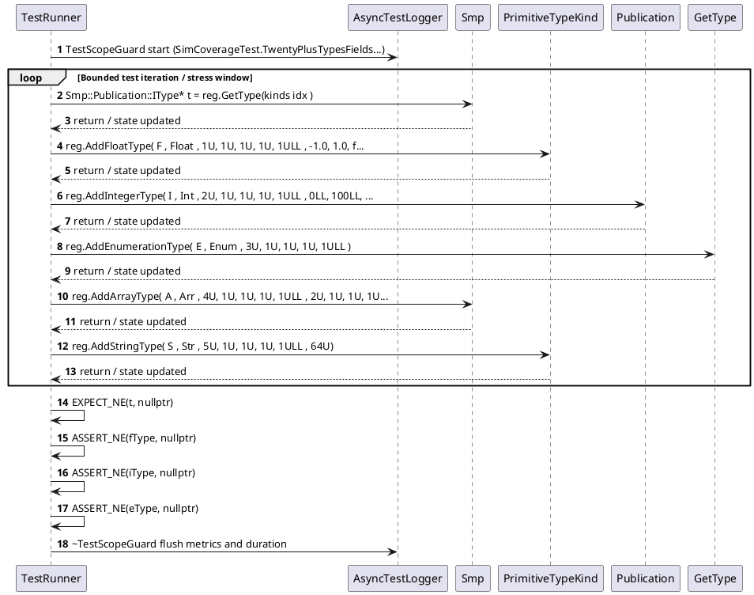

# Test Case: `SimCoverageTest.TwentyPlusTypesFieldsAndEnumStreams`

| Property | Value |
| :--- | :--- |
| **Module** | `sim` |
| **Source File** | `cmake-projects/sim/test/TestSimExtended.cpp` (lines 319–397) |
| **Category** | Template / Polymorphic Breadth (`CS-0100.5`) |
| **Traceability** | `TSK-20261113-004`, `FE-0070.9,`, `CS-0090.1,` |
| **Async Telemetry** | Enabled (`TestScopeGuard` + `AsyncTestLogger`) |

## Summary

Tests 20+ primitive types, field publication overloads, and `TypeRegistry` type builders.

## Sequence Diagram

## Observed Operations

- `Smp::Publication::IType* t = reg.GetType(kinds[idx])`
- `reg.AddFloatType("F", "Float", {1U, 1U, 1U, 1U, 1ULL}, -1.0, 1.0, false, true, "rad")`
- `reg.AddIntegerType("I", "Int", {2U, 1U, 1U, 1U, 1ULL}, 0LL, 100LL, "pct")`
- `reg.AddEnumerationType("E", "Enum", {3U, 1U, 1U, 1U, 1ULL})`
- `reg.AddArrayType("A", "Arr", {4U, 1U, 1U, 1U, 1ULL}, {2U, 1U, 1U, 1U, 1ULL}, 4U, 8U, true)`
- `reg.AddStringType("S", "Str", {5U, 1U, 1U, 1U, 1ULL}, 64U)`
- `reg.AddStructureType("St", "Struct", {6U, 1U, 1U, 1U, 1ULL})`
- `reg.AddClassType("C", "Class", {7U, 1U, 1U, 1U, 1ULL}, {6U, 1U, 1U, 1U, 1ULL})`

## Verification Assertions

- `EXPECT_NE(t, nullptr)`
- `ASSERT_NE(fType, nullptr)`
- `ASSERT_NE(iType, nullptr)`
- `ASSERT_NE(eType, nullptr)`
- `ASSERT_NE(aType, nullptr)`
- `ASSERT_NE(sType, nullptr)`
- `ASSERT_NE(stType, nullptr)`
- `ASSERT_NE(cType, nullptr)`
- `EXPECT_EQ(sType->GetMaxLength(), 64U)`
- `EXPECT_EQ(aType->GetSize(), 32U)`

---

[Back to `sim` Tests Overview](../sim.md)
