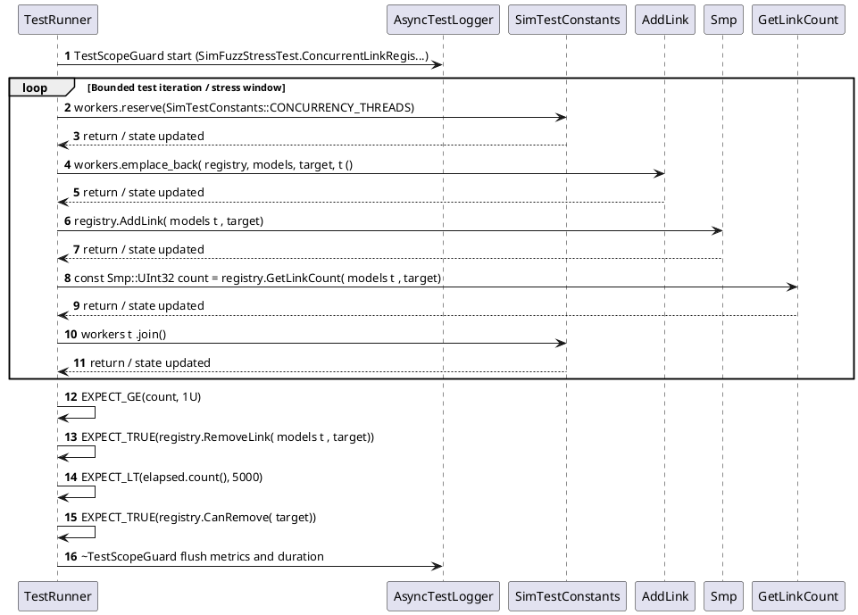

# Test Case: `SimFuzzStressTest.ConcurrentLinkRegistryStress`

| Property | Value |
| :--- | :--- |
| **Module** | `sim` |
| **Source File** | `cmake-projects/sim/test/TestSimExtended.cpp` (lines 482–513) |
| **Category** | Determinism, Fuzzing, Concurrency & Stress (`CS-0100.7`, `CS-0100.10`, `CS-0100.11`, `CS-0100.12`) |
| **Traceability** | `TSK-20261113-004`, `FE-0070.6`, `CS-0090.1,` |
| **Async Telemetry** | Enabled (`TestScopeGuard` + `AsyncTestLogger`) |

## Summary

Exercises concurrent `LinkRegistry` link/query/remove cycles across threads.

## Sequence Diagram

## Observed Operations

- `workers.reserve(SimTestConstants::CONCURRENCY_THREADS)`
- `workers.emplace_back([&registry, &models, &target, t]() {`
- `registry.AddLink(&models[t], &target)`
- `const Smp::UInt32 count = registry.GetLinkCount(&models[t], &target)`
- `workers[t].join()`

## Verification Assertions

- `EXPECT_GE(count, 1U)`
- `EXPECT_TRUE(registry.RemoveLink(&models[t], &target))`
- `EXPECT_LT(elapsed.count(), 5000)`
- `EXPECT_TRUE(registry.CanRemove(&target))`

---

[Back to `sim` Tests Overview](../sim.md)
