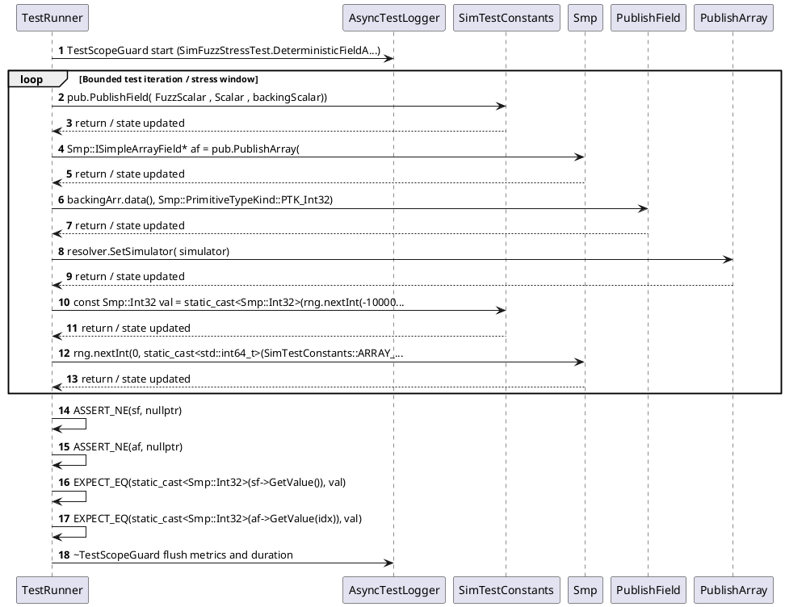

# Test Case: `SimFuzzStressTest.DeterministicFieldAndResolverFuzzing`

| Property | Value |
| :--- | :--- |
| **Module** | `sim` |
| **Source File** | `cmake-projects/sim/test/TestSimExtended.cpp` (lines 439–473) |
| **Category** | Determinism, Fuzzing, Concurrency & Stress (`CS-0100.7`, `CS-0100.10`, `CS-0100.11`, `CS-0100.12`) |
| **Traceability** | `TSK-20261113-004`, `FE-0060.11,`, `CS-0090.1,` |
| **Async Telemetry** | Enabled (`TestScopeGuard` + `AsyncTestLogger`) |

## Summary

Performs deterministic seeded fuzzing on `SimpleField`, `SimpleArrayField`, and `Resolver`.

## Sequence Diagram

## Observed Operations

- `pub.PublishField("FuzzScalar", "Scalar", &backingScalar))`
- `Smp::ISimpleArrayField* af = pub.PublishArray(`
- `backingArr.data(), Smp::PrimitiveTypeKind::PTK_Int32)`
- `resolver.SetSimulator(&simulator)`
- `const Smp::Int32 val = static_cast<Smp::Int32>(rng.nextInt(-10000, 10000))`
- `rng.nextInt(0, static_cast<std::int64_t>(SimTestConstants::ARRAY_LEN) - 1))`
- `sf->SetValue(Smp::AnySimple(Smp::PrimitiveTypeKind::PTK_Int32, val))`
- `af->SetValue(idx, Smp::AnySimple(Smp::PrimitiveTypeKind::PTK_Int32, val))`

## Verification Assertions

- `ASSERT_NE(sf, nullptr)`
- `ASSERT_NE(af, nullptr)`
- `EXPECT_EQ(static_cast<Smp::Int32>(sf->GetValue()), val)`
- `EXPECT_EQ(static_cast<Smp::Int32>(af->GetValue(idx)), val)`
- `EXPECT_EQ(resolver.ResolveAbsolute("/Unknown/Node"), nullptr)`
- `EXPECT_EQ(resolver.ResolveRelative("Missing", &simulator), nullptr)`

---

[Back to `sim` Tests Overview](../sim.md)
