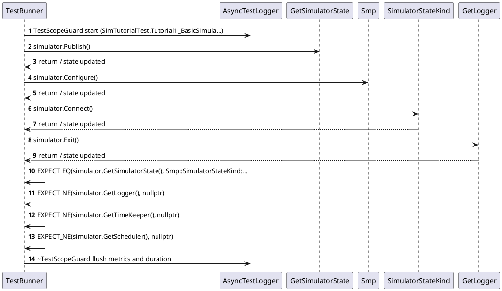

# Test Case: `SimTutorialTest.Tutorial1_BasicSimulatorLifecycle`

| Property | Value |
| :--- | :--- |
| **Module** | `sim` |
| **Source File** | `cmake-projects/sim/test/TestSimExtended.cpp` (lines 208–227) |
| **Category** | Pedagogical Tutorial (`CS-0100.19`) |
| **Traceability** | `TSK-20261113-004`, `FE-0070.7`, `CS-0090.1,` |
| **Async Telemetry** | Enabled (`TestScopeGuard` + `AsyncTestLogger`) |

## Summary

Tutorial 1 (Basic): Create a `Simulator`, inspect default services, and cycle states.

## Sequence Diagram

## Observed Operations

- `simulator.Publish()`
- `simulator.Configure()`
- `simulator.Connect()`
- `simulator.Exit()`

## Verification Assertions

- `EXPECT_EQ(simulator.GetSimulatorState(), Smp::SimulatorStateKind::SSK_Building)`
- `EXPECT_NE(simulator.GetLogger(), nullptr)`
- `EXPECT_NE(simulator.GetTimeKeeper(), nullptr)`
- `EXPECT_NE(simulator.GetScheduler(), nullptr)`
- `EXPECT_NE(simulator.GetEventManager(), nullptr)`
- `EXPECT_NE(simulator.GetResolver(), nullptr)`
- `EXPECT_NE(simulator.GetLinkRegistry(), nullptr)`
- `EXPECT_NE(simulator.GetTypeRegistry(), nullptr)`
- `EXPECT_EQ(simulator.GetSimulatorState(), Smp::SimulatorStateKind::SSK_Standby)`
- `EXPECT_EQ(simulator.GetSimulatorState(), Smp::SimulatorStateKind::SSK_Exiting)`

---

[Back to `sim` Tests Overview](../sim.md)
