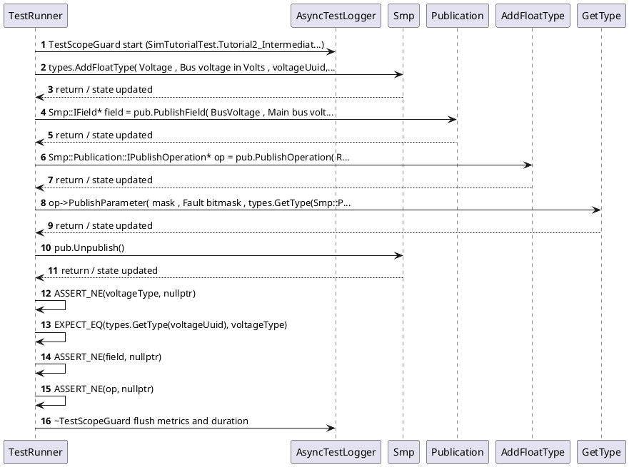

# Test Case: `SimTutorialTest.Tutorial2_IntermediateTypeRegistryAndPublication`

| Property | Value |
| :--- | :--- |
| **Module** | `sim` |
| **Source File** | `cmake-projects/sim/test/TestSimExtended.cpp` (lines 236–261) |
| **Category** | Pedagogical Tutorial (`CS-0100.19`) |
| **Traceability** | `TSK-20261113-004`, `FE-0070.9,`, `CS-0090.1,` |
| **Async Telemetry** | Enabled (`TestScopeGuard` + `AsyncTestLogger`) |

## Summary

Tutorial 2 (Intermediate): Register custom SMP types and publish model fields & operations.

## Sequence Diagram

## Observed Operations

- `types.AddFloatType("Voltage", "Bus voltage in Volts", voltageUuid, -60.0, 60.0, true, true, "V")`
- `Smp::IField* field = pub.PublishField("BusVoltage", "Main bus voltage", &busVoltage)`
- `Smp::Publication::IPublishOperation* op = pub.PublishOperation("ResetFaults", "Clears fault flags")`
- `op->PublishParameter("mask", "Fault bitmask", types.GetType(Smp::PrimitiveTypeKind::PTK_UInt32)->GetUuid(),`
- `pub.Unpublish()`

## Verification Assertions

- `ASSERT_NE(voltageType, nullptr)`
- `EXPECT_EQ(types.GetType(voltageUuid), voltageType)`
- `ASSERT_NE(field, nullptr)`
- `ASSERT_NE(op, nullptr)`
- `EXPECT_EQ(pub.GetField("BusVoltage"), field)`
- `EXPECT_NE(pub.GetFields(), nullptr)`
- `EXPECT_EQ(pub.GetOperation("ResetFaults"), nullptr)`
- `EXPECT_EQ(pub.GetOperations(), nullptr)`
- `EXPECT_EQ(pub.GetProperties(), nullptr)`

---

[Back to `sim` Tests Overview](../sim.md)
