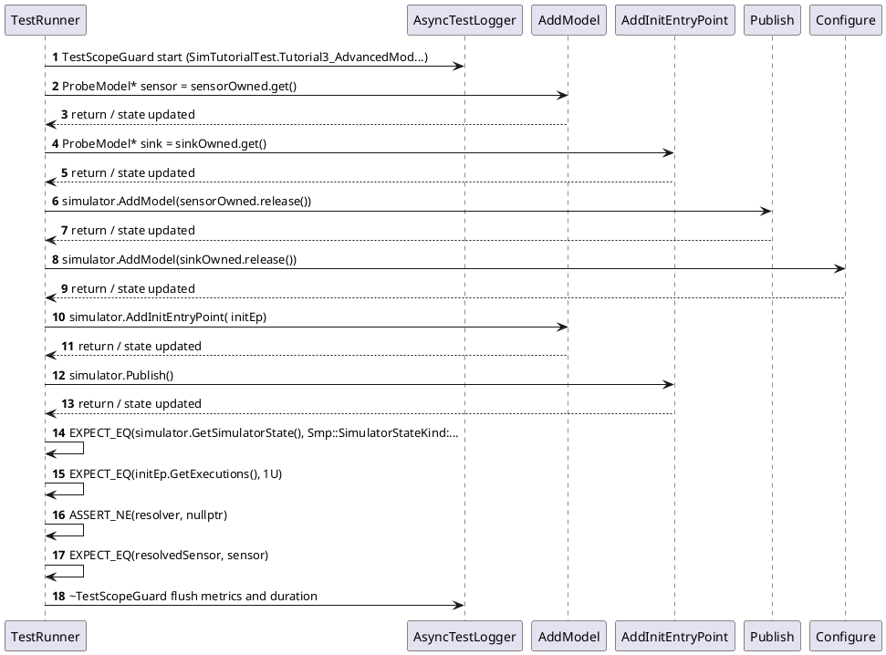

# Test Case: `SimTutorialTest.Tutorial3_AdvancedModelResolverLinksAndTimedRun`

| Property | Value |
| :--- | :--- |
| **Module** | `sim` |
| **Source File** | `cmake-projects/sim/test/TestSimExtended.cpp` (lines 270–306) |
| **Category** | Pedagogical Tutorial (`CS-0100.19`) |
| **Traceability** | `TSK-20261113-004`, `FE-0070.5,`, `CS-0090.1,` |
| **Async Telemetry** | Enabled (`TestScopeGuard` + `AsyncTestLogger`) |

## Summary

Tutorial 3 (Advanced): Wire `ProbeModel`, `Resolver`, `LinkRegistry`, and timed `Run(duration)`.

## Sequence Diagram

## Observed Operations

- `ProbeModel* sensor = sensorOwned.get()`
- `ProbeModel* sink = sinkOwned.get()`
- `simulator.AddModel(sensorOwned.release())`
- `simulator.AddModel(sinkOwned.release())`
- `simulator.AddInitEntryPoint(&initEp)`
- `simulator.Publish()`
- `simulator.Configure()`
- `simulator.Connect()`

## Verification Assertions

- `EXPECT_EQ(simulator.GetSimulatorState(), Smp::SimulatorStateKind::SSK_Standby)`
- `EXPECT_EQ(initEp.GetExecutions(), 1U)`
- `ASSERT_NE(resolver, nullptr)`
- `EXPECT_EQ(resolvedSensor, sensor)`
- `ASSERT_NE(links, nullptr)`
- `EXPECT_EQ(links->GetLinkCount(sensor, sink), 1U)`
- `EXPECT_FALSE(links->CanRemove(sink))`
- `EXPECT_TRUE(links->CanRemove(sink))`

---

[Back to `sim` Tests Overview](../sim.md)
