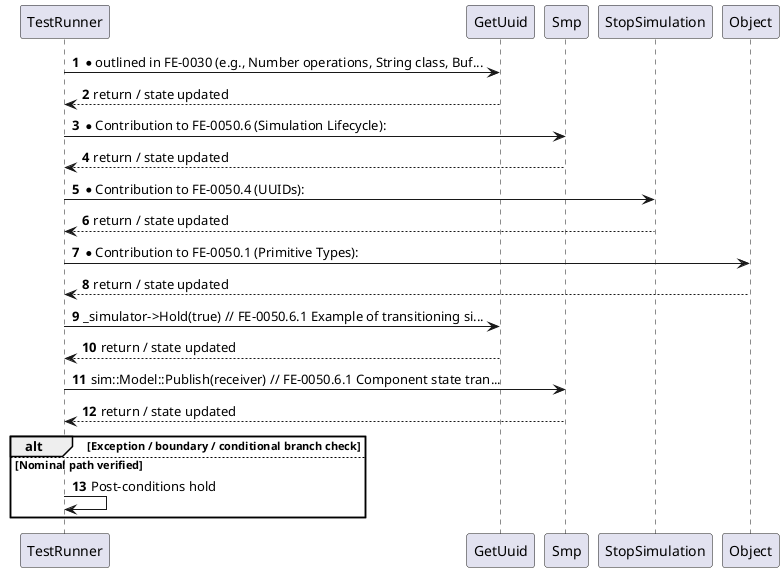

# Test Case: `test_basic_simulation`

| Property | Value |
| :--- | :--- |
| **Module** | `sim` |
| **Source File** | `cmake-projects/sim/test/test_basic_simulation.cpp` (lines 1–183) |
| **Category** | Unit & Regression Verification |
| **Traceability** | See module specification (`FE-*` / `TSK-*`) |
| **Async Telemetry** | Standard GTest / CTest stdout |

## Summary

Test file for basic simulator functionality.

## Sequence Diagram

## Observed Operations

- `*   outlined in FE-0030 (e.g., Number operations, String class, Buffer/BitBuffer`
- `* Contribution to FE-0050.6 (Simulation Lifecycle):`
- `* Contribution to FE-0050.4 (UUIDs):`
- `* Contribution to FE-0050.1 (Primitive Types):`
- `_simulator->Hold(true); // [FE-0050.6.1] Example of transitioning simulation state (Executing -> Standby via Hold).`
- `sim::Model::Publish(receiver); // [FE-0050.6.1] Component state transition: Created -> Publishing.`
- `sim::Model::Configure(logger, linkRegistry); // [FE-0050.6.1] Component state transition: Publishing -> Configured.`
- `sim::Model::Connect(simulator); // [FE-0050.6.1] Component state transition: Configured -> Connected.`

## Verification Assertions

- Verified via exit status `0` and runtime checks inside executable.

---

[Back to `sim` Tests Overview](../sim.md)
