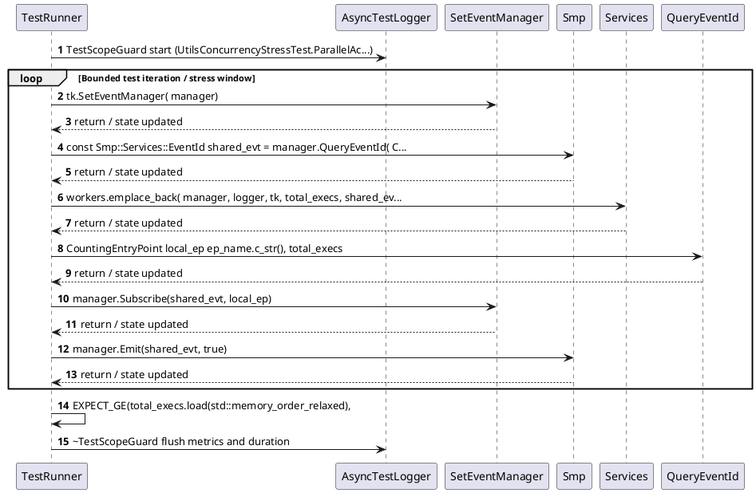

# Test Case: `UtilsConcurrencyStressTest.ParallelAccessAndLifecycleChurn`

| Property | Value |
| :--- | :--- |
| **Module** | `utils` |
| **Source File** | `cmake-projects/utils/test/TestUtils.cpp` (lines 372–405) |
| **Category** | Determinism, Fuzzing, Concurrency & Stress (`CS-0100.7`, `CS-0100.10`, `CS-0100.11`, `CS-0100.12`) |
| **Traceability** | `TSK-20261113-004`, `FE-0070`, `CS-0010.37,` |
| **Async Telemetry** | Enabled (`TestScopeGuard` + `AsyncTestLogger`) |

## Summary

Concurrent multi-thread access, creation, destruction, and stress across utils services.

## Sequence Diagram

## Observed Operations

- `tk.SetEventManager(&manager)`
- `const Smp::Services::EventId shared_evt = manager.QueryEventId("ConcurrentSharedEvent")`
- `workers.emplace_back([&manager, &logger, &tk, &total_execs, shared_evt, t_idx]() {`
- `CountingEntryPoint local_ep{ep_name.c_str(), total_execs}`
- `manager.Subscribe(shared_evt, &local_ep)`
- `manager.Emit(shared_evt, true)`
- `tk.SetSimulationTime(static_cast<Smp::Duration>(iter))`
- `(void)tk.GetSimulationTime()`

## Verification Assertions

- `EXPECT_GE(total_execs.load(std::memory_order_relaxed),`

---

[Back to `utils` Tests Overview](../utils.md)
