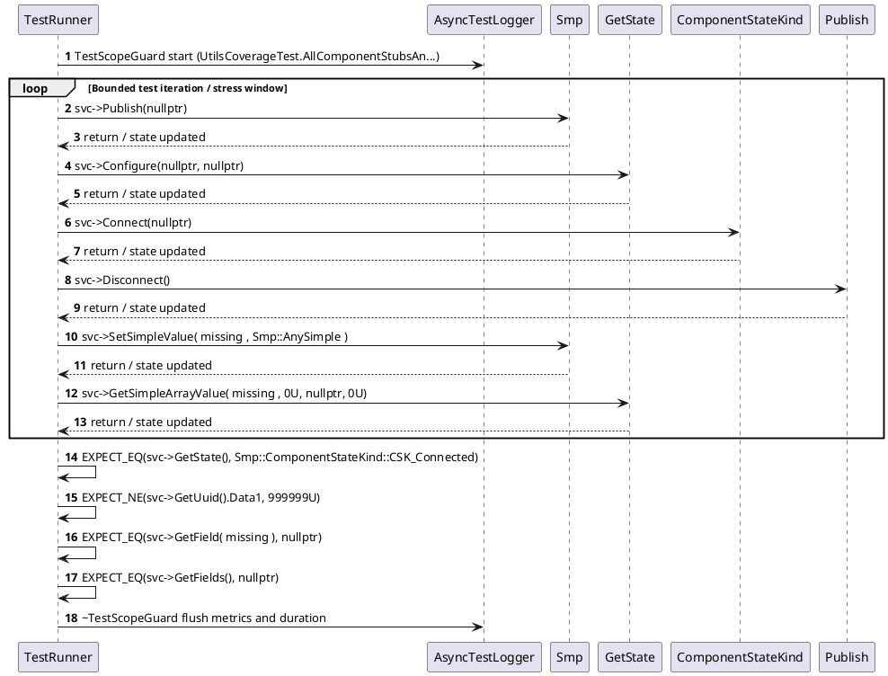

# Test Case: `UtilsCoverageTest.AllComponentStubsAndMetadata`

| Property | Value |
| :--- | :--- |
| **Module** | `utils` |
| **Source File** | `cmake-projects/utils/test/TestUtils.cpp` (lines 186–213) |
| **Category** | Coverage, Enum, Boundary & Exception Containment (`CS-0100.1`, `CS-0100.3`, `CS-0100.4`, `CS-0100.6`, `CS-0100.9`) |
| **Traceability** | `TSK-20261113-004`, `FE-0070,`, `CS-0090.1,` |
| **Async Telemetry** | Enabled (`TestScopeGuard` + `AsyncTestLogger`) |

## Summary

Verifies all EventManager, Logger, and TimeKeeper IComponent stubs and metadata.

## Sequence Diagram

## Observed Operations

- `svc->Publish(nullptr)`
- `svc->Configure(nullptr, nullptr)`
- `svc->Connect(nullptr)`
- `svc->Disconnect()`
- `svc->SetSimpleValue("missing", Smp::AnySimple{})`
- `svc->GetSimpleArrayValue("missing", 0U, nullptr, 0U)`
- `svc->SetSimpleArrayValue("missing", 0U, nullptr, 0U)`

## Verification Assertions

- `EXPECT_EQ(svc->GetState(), Smp::ComponentStateKind::CSK_Connected)`
- `EXPECT_NE(svc->GetUuid().Data1, 999999U)`
- `EXPECT_EQ(svc->GetField("missing"), nullptr)`
- `EXPECT_EQ(svc->GetFields(), nullptr)`
- `EXPECT_EQ(static_cast<int>(svc->GetSimpleValue("missing").type),`
- `EXPECT_FALSE(svc->AddChild(nullptr, nullptr))`
- `EXPECT_FALSE(svc->RemoveChild(nullptr, nullptr))`
- `EXPECT_EQ(svc->IsChildInCollection(nullptr, nullptr), nullptr)`
- `EXPECT_EQ(svc->GetChild(nullptr), nullptr)`

---

[Back to `utils` Tests Overview](../utils.md)
