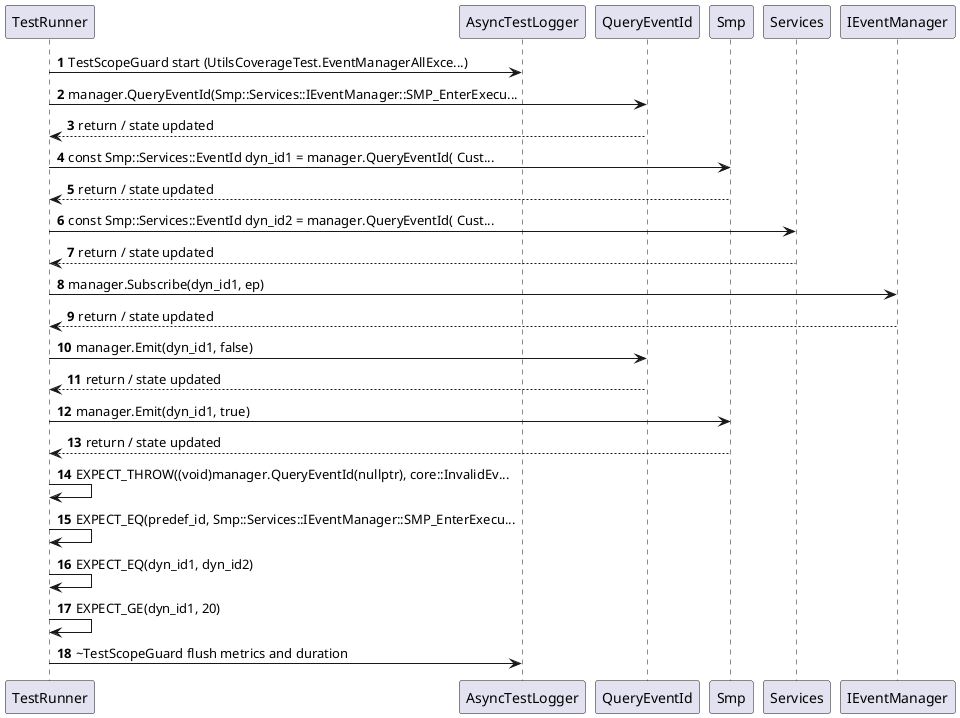

# Test Case: `UtilsCoverageTest.EventManagerAllExceptionSourcesAndBranches`

| Property | Value |
| :--- | :--- |
| **Module** | `utils` |
| **Source File** | `cmake-projects/utils/test/TestUtils.cpp` (lines 261–301) |
| **Category** | Coverage, Enum, Boundary & Exception Containment (`CS-0100.1`, `CS-0100.3`, `CS-0100.4`, `CS-0100.6`, `CS-0100.9`) |
| **Traceability** | `TSK-20261113-004`, `FE-0070.4`, `CS-0090.1,` |
| **Async Telemetry** | Enabled (`TestScopeGuard` + `AsyncTestLogger`) |

## Summary

Verifies all EventManager exception sources, predefined events, and synchronous flags.

## Sequence Diagram

## Observed Operations

- `manager.QueryEventId(Smp::Services::IEventManager::SMP_EnterExecuting)`
- `const Smp::Services::EventId dyn_id1 = manager.QueryEventId("CustomDynEvent")`
- `const Smp::Services::EventId dyn_id2 = manager.QueryEventId("CustomDynEvent")`
- `manager.Subscribe(dyn_id1, &ep)`
- `manager.Emit(dyn_id1, false)`
- `manager.Emit(dyn_id1, true)`
- `manager.Emit(999999, true)`
- `manager.Unsubscribe(dyn_id1, &ep)`

## Verification Assertions

- `EXPECT_THROW((void)manager.QueryEventId(nullptr), core::InvalidEventName)`
- `EXPECT_EQ(predef_id, Smp::Services::IEventManager::SMP_EnterExecutingId)`
- `EXPECT_EQ(dyn_id1, dyn_id2)`
- `EXPECT_GE(dyn_id1, 20)`
- `EXPECT_THROW(manager.Subscribe(dyn_id1, nullptr), std::invalid_argument)`
- `EXPECT_THROW(manager.Unsubscribe(dyn_id1, nullptr), std::invalid_argument)`
- `EXPECT_THROW(manager.Subscribe(dyn_id1, &ep), core::EntryPointAlreadySubscribed)`
- `EXPECT_EQ(calls.load(std::memory_order_relaxed), 2U)`
- `EXPECT_THROW(manager.Unsubscribe(dyn_id1, &ep), core::EntryPointNotSubscribed)`
- `EXPECT_THROW(manager.Unsubscribe(888888, &ep), core::EntryPointNotSubscribed)`

---

[Back to `utils` Tests Overview](../utils.md)
