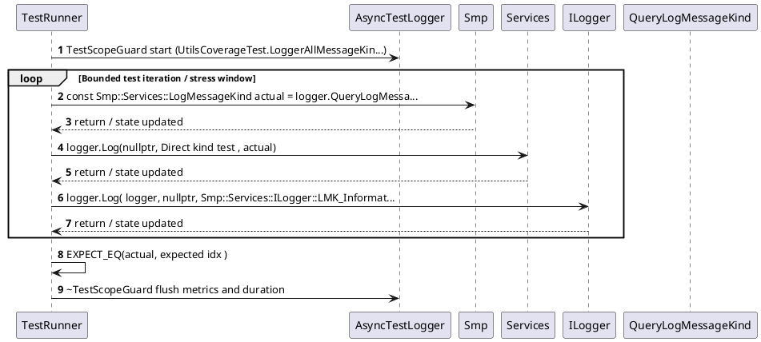

# Test Case: `UtilsCoverageTest.LoggerAllMessageKindsAndNullGuards`

| Property | Value |
| :--- | :--- |
| **Module** | `utils` |
| **Source File** | `cmake-projects/utils/test/TestUtils.cpp` (lines 222–252) |
| **Category** | Coverage, Enum, Boundary & Exception Containment (`CS-0100.1`, `CS-0100.3`, `CS-0100.4`, `CS-0100.6`, `CS-0100.9`) |
| **Traceability** | `TSK-20261113-004`, `FE-0070.1`, `CS-0090.1,` |
| **Async Telemetry** | Enabled (`TestScopeGuard` + `AsyncTestLogger`) |

## Summary

Exhaustively tests all predefined SMP log kinds and unknown/null inputs on Logger.

## Sequence Diagram

## Observed Operations

- `const Smp::Services::LogMessageKind actual = logger.QueryLogMessageKind(names[idx])`
- `logger.Log(nullptr, "Direct kind test", actual)`
- `logger.Log(&logger, nullptr, Smp::Services::ILogger::LMK_Information)`

## Verification Assertions

- `EXPECT_EQ(actual, expected[idx])`

---

[Back to `utils` Tests Overview](../utils.md)
