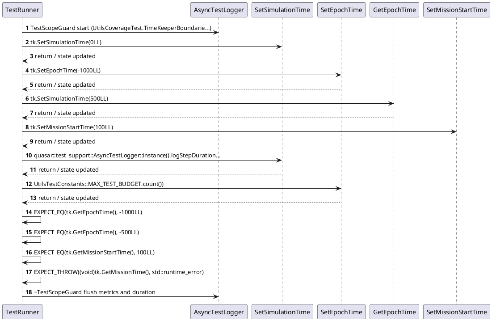

# Test Case: `UtilsCoverageTest.TimeKeeperBoundariesAndTimeoutContainment`

| Property | Value |
| :--- | :--- |
| **Module** | `utils` |
| **Source File** | `cmake-projects/utils/test/TestUtils.cpp` (lines 310–331) |
| **Category** | Coverage, Enum, Boundary & Exception Containment (`CS-0100.1`, `CS-0100.3`, `CS-0100.4`, `CS-0100.6`, `CS-0100.9`) |
| **Traceability** | `TSK-20261113-004`, `FE-0070.2`, `CS-0090.1,` |
| **Async Telemetry** | Enabled (`TestScopeGuard` + `AsyncTestLogger`) |

## Summary

Verifies TimeKeeper boundaries and GetMissionTime nested-lock timeout containment.

## Sequence Diagram

## Observed Operations

- `tk.SetSimulationTime(0LL)`
- `tk.SetEpochTime(-1000LL)`
- `tk.SetSimulationTime(500LL)`
- `tk.SetMissionStartTime(100LL)`
- `quasar::test_support::AsyncTestLogger::instance().logStepDuration("GetMissionTime_timeout", t0, t1)`
- `UtilsTestConstants::MAX_TEST_BUDGET.count())`

## Verification Assertions

- `EXPECT_EQ(tk.GetEpochTime(), -1000LL)`
- `EXPECT_EQ(tk.GetEpochTime(), -500LL)`
- `EXPECT_EQ(tk.GetMissionStartTime(), 100LL)`
- `EXPECT_THROW((void)tk.GetMissionTime(), std::runtime_error)`
- `EXPECT_LT(std::chrono::duration_cast<std::chrono::milliseconds>(t1 - t0).count(),`

---

[Back to `utils` Tests Overview](../utils.md)
