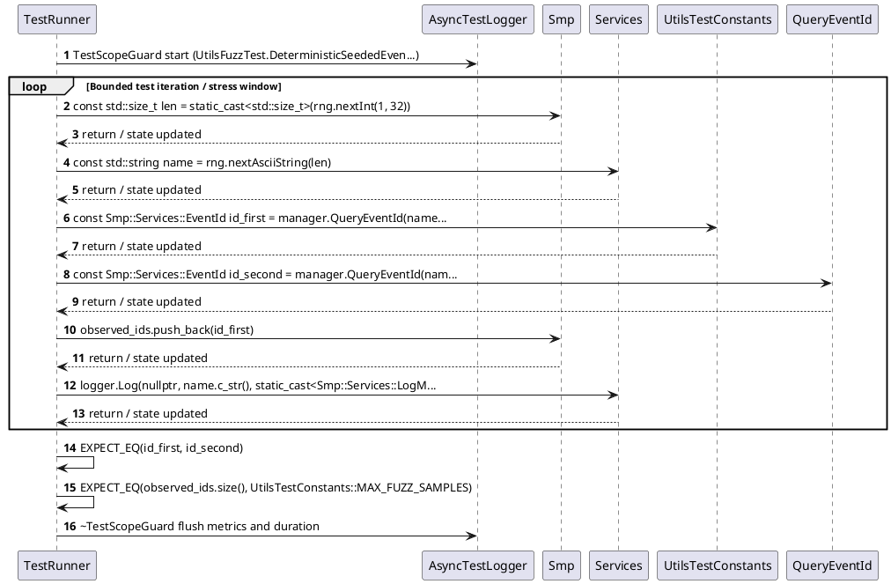

# Test Case: `UtilsFuzzTest.DeterministicSeededEventAndLogFuzzing`

| Property | Value |
| :--- | :--- |
| **Module** | `utils` |
| **Source File** | `cmake-projects/utils/test/TestUtils.cpp` (lines 344–363) |
| **Category** | Determinism, Fuzzing, Concurrency & Stress (`CS-0100.7`, `CS-0100.10`, `CS-0100.11`, `CS-0100.12`) |
| **Traceability** | `TSK-20261113-004`, `FE-0070`, `CS-0010.37,` |
| **Async Telemetry** | Enabled (`TestScopeGuard` + `AsyncTestLogger`) |

## Summary

Deterministic seeded fuzzing of EventManager names and Logger strings.

## Sequence Diagram

## Observed Operations

- `const std::size_t len = static_cast<std::size_t>(rng.nextInt(1, 32))`
- `const std::string name = rng.nextAsciiString(len)`
- `const Smp::Services::EventId id_first = manager.QueryEventId(name.c_str())`
- `const Smp::Services::EventId id_second = manager.QueryEventId(name.c_str())`
- `observed_ids.push_back(id_first)`
- `logger.Log(nullptr, name.c_str(), static_cast<Smp::Services::LogMessageKind>(rng.nextInt(-2, 6)))`
- `quasar::test_support::AsyncTestLogger::instance().logLoopProgress(`

## Verification Assertions

- `EXPECT_EQ(id_first, id_second)`
- `EXPECT_EQ(observed_ids.size(), UtilsTestConstants::MAX_FUZZ_SAMPLES)`

---

[Back to `utils` Tests Overview](../utils.md)
