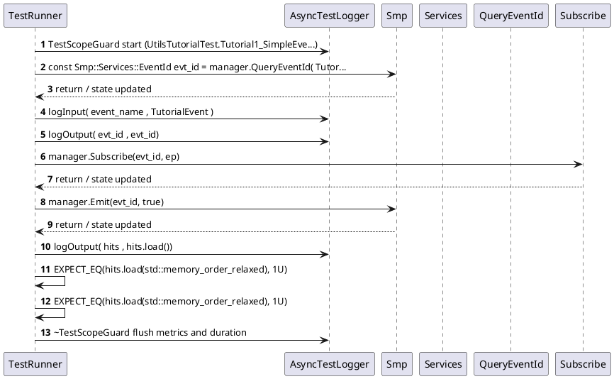

# Test Case: `UtilsTutorialTest.Tutorial1_SimpleEventManagerFlow`

| Property | Value |
| :--- | :--- |
| **Module** | `utils` |
| **Source File** | `cmake-projects/utils/test/TestUtils.cpp` (lines 87–108) |
| **Category** | Pedagogical Tutorial (`CS-0100.19`) |
| **Traceability** | `TSK-20261113-004`, `FE-0070.4`, `CS-0090.1,` |
| **Async Telemetry** | Enabled (`TestScopeGuard` + `AsyncTestLogger`) |

## Summary

Tutorial 1 (Simple): Minimal EventManager subscription and emission workflow.

## Sequence Diagram

## Observed Operations

- `const Smp::Services::EventId evt_id = manager.QueryEventId("TutorialEvent")`
- `logInput("event_name", "TutorialEvent")`
- `logOutput("evt_id", evt_id)`
- `manager.Subscribe(evt_id, &ep)`
- `manager.Emit(evt_id, true)`
- `logOutput("hits", hits.load())`
- `manager.Unsubscribe(evt_id, &ep)`
- `manager.Emit(evt_id, true)`

## Verification Assertions

- `EXPECT_EQ(hits.load(std::memory_order_relaxed), 1U)`
- `EXPECT_EQ(hits.load(std::memory_order_relaxed), 1U)`

---

[Back to `utils` Tests Overview](../utils.md)
