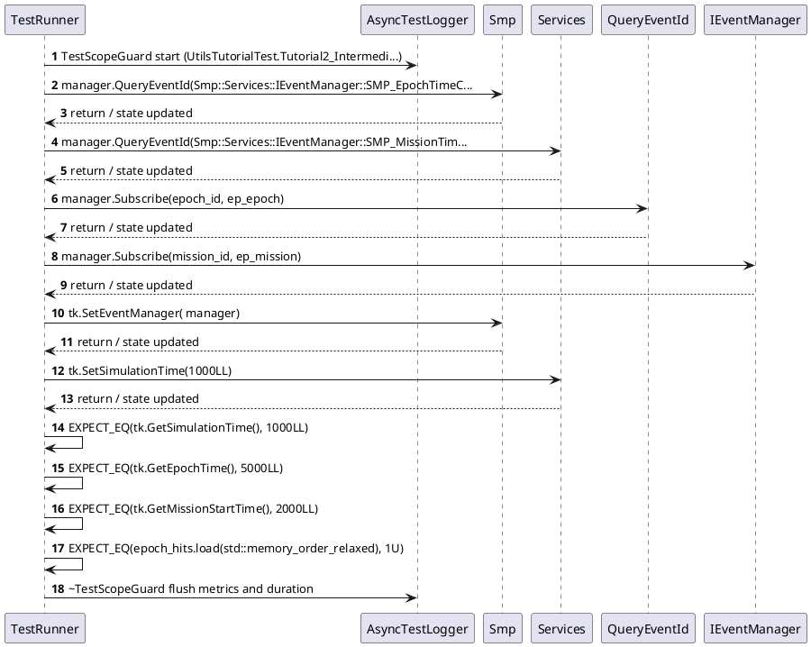

# Test Case: `UtilsTutorialTest.Tutorial2_IntermediateTimeKeeperWithEvents`

| Property | Value |
| :--- | :--- |
| **Module** | `utils` |
| **Source File** | `cmake-projects/utils/test/TestUtils.cpp` (lines 117–144) |
| **Category** | Pedagogical Tutorial (`CS-0100.19`) |
| **Traceability** | `TSK-20261113-004`, `FE-0070.2,`, `CS-0090.1,` |
| **Async Telemetry** | Enabled (`TestScopeGuard` + `AsyncTestLogger`) |

## Summary

Tutorial 2 (Intermediate): Coupled TimeKeeper and EventManager notifications.

## Sequence Diagram

## Observed Operations

- `manager.QueryEventId(Smp::Services::IEventManager::SMP_EpochTimeChanged)`
- `manager.QueryEventId(Smp::Services::IEventManager::SMP_MissionTimeChanged)`
- `manager.Subscribe(epoch_id, &ep_epoch)`
- `manager.Subscribe(mission_id, &ep_mission)`
- `tk.SetEventManager(&manager)`
- `tk.SetSimulationTime(1000LL)`
- `tk.SetEpochTime(5000LL)`
- `tk.SetMissionStartTime(2000LL)`

## Verification Assertions

- `EXPECT_EQ(tk.GetSimulationTime(), 1000LL)`
- `EXPECT_EQ(tk.GetEpochTime(), 5000LL)`
- `EXPECT_EQ(tk.GetMissionStartTime(), 2000LL)`
- `EXPECT_EQ(epoch_hits.load(std::memory_order_relaxed), 1U)`
- `EXPECT_EQ(mission_hits.load(std::memory_order_relaxed), 1U)`

---

[Back to `utils` Tests Overview](../utils.md)
