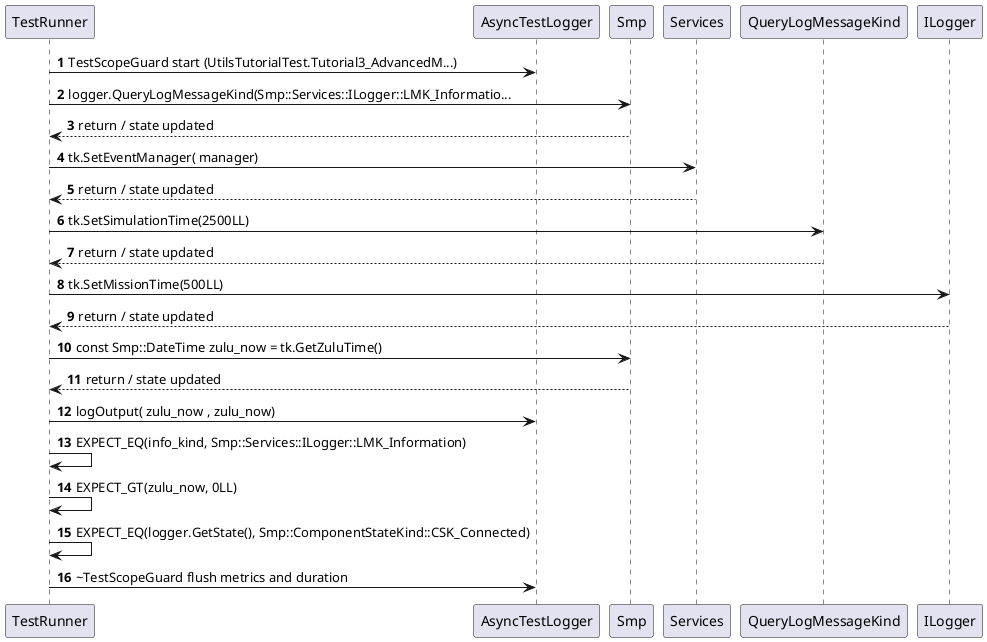

# Test Case: `UtilsTutorialTest.Tutorial3_AdvancedMultiServiceComposition`

| Property | Value |
| :--- | :--- |
| **Module** | `utils` |
| **Source File** | `cmake-projects/utils/test/TestUtils.cpp` (lines 153–173) |
| **Category** | Pedagogical Tutorial (`CS-0100.19`) |
| **Traceability** | `TSK-20261113-004`, `FE-0070.1,`, `CS-0090.1,` |
| **Async Telemetry** | Enabled (`TestScopeGuard` + `AsyncTestLogger`) |

## Summary

Tutorial 3 (Advanced): Multi-service Logger, TimeKeeper, and re-entrant EventManager chain.

## Sequence Diagram

## Observed Operations

- `logger.QueryLogMessageKind(Smp::Services::ILogger::LMK_InformationName)`
- `tk.SetEventManager(&manager)`
- `tk.SetSimulationTime(2500LL)`
- `tk.SetMissionTime(500LL)`
- `const Smp::DateTime zulu_now = tk.GetZuluTime()`
- `logOutput("zulu_now", zulu_now)`
- `logger.Log(&tk, "Tutorial 3 simulation checkpoint", info_kind)`

## Verification Assertions

- `EXPECT_EQ(info_kind, Smp::Services::ILogger::LMK_Information)`
- `EXPECT_GT(zulu_now, 0LL)`
- `EXPECT_EQ(logger.GetState(), Smp::ComponentStateKind::CSK_Connected)`

---

[Back to `utils` Tests Overview](../utils.md)
